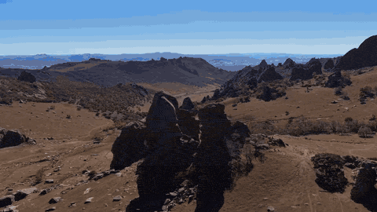
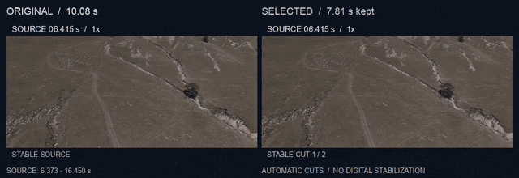
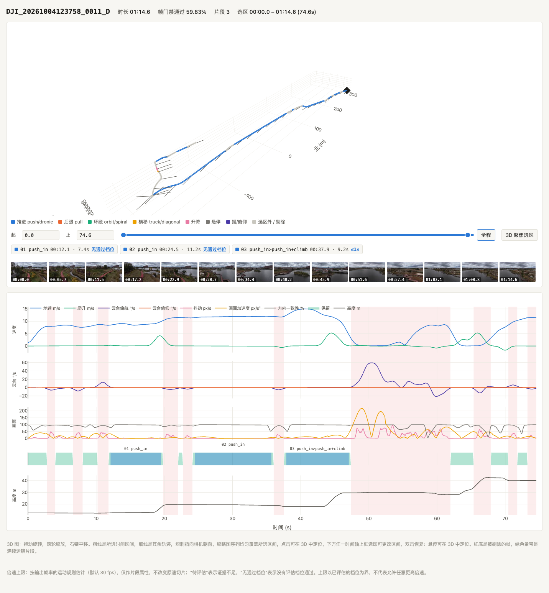

# dronesift

**Sift an hour of drone footage down to the good takes — automatically.**

[](docs/media/steady-moves.mp4)

*12 seconds of real v6 selections, at natural speed. [Watch the 960px MP4](docs/media/steady-moves.mp4).*

dronesift watches your DJI footage the way an editor would: it finds the steady, continuous
camera moves (push-ins, orbits, dronies, trucking shots), labels them, and hands you
ready-to-use clips plus an [EDL](https://en.wikipedia.org/wiki/Edit_decision_list) you can drop
straight into DaVinci Resolve, Premiere Pro or Final Cut — original files untouched.

Every run also produces an interactive HTML report: a 3D flight trajectory coloured
by move type, estimated camera-direction ticks, aligned speed / gimbal / image-motion /
keep timelines, and a thumbnail strip you can scrub. Measurements and thumbnails are
embedded in the file; the chart library and web fonts load from the network.

## See a real cut

[](docs/media/cut-comparison.mp4)

**10.08 seconds of source → two stable clips totalling 7.81 seconds.** The red interval
contains a stick correction and its settling margins. The selected output joins the two
usable source ranges at a hard cut; its end card marks completion while the original
finishes playing. Both sides play at natural speed.

[Watch the MP4 comparison](docs/media/cut-comparison.mp4) · [Source ranges and reproduction](docs/showcase.md)

## Read the flight, then watch the clip

[](docs/showcase.md#flight-analysis--航拍分析)

One real flight, with **three selected ranges totalling 27.83 seconds from 74.59 seconds**.
The linked plots show aircraft speed, gimbal yaw/pitch rates, image motion and altitude
along the same time axis. The header's accepted-frame percentage precedes the trimming
and minimum-length rules that produce the final clip ranges.

[Watch an 8-second selection from this flight](docs/media/analysis-selection.mp4) ·
[Zoom into the timeline](docs/media/analysis-timeline.png) ·
[Interactive HTML example](docs/examples/flight-report.html) (open from a cloned/downloaded project; keep the `docs` directory structure; charts need internet)

## Why

Reviewing flight footage is a chore: for every usable 20-second orbit there are minutes of
takeoff, hovering, stick twitches and aborted moves. dronesift fuses two signals to judge every
frame — **what the camera did** (per-frame gimbal attitude, velocity and acceleration parsed
from the MP4 itself) and **what the image did** (optical-flow motion, jitter, sharpness,
exposure steps) — then keeps only the frames where both say "this is a clean move".

## Install

Requires Python 3.12+, [uv](https://docs.astral.sh/uv/), and ffmpeg/ffprobe with HEVC support
(on macOS: `brew install ffmpeg uv`).

```bash
git clone https://github.com/zhoutingunl/dronesift && cd dronesift
uv sync
uv run python -m dronesift /path/to/DJI_0001.D.MP4
```

Or after `uv sync`, the console script works too: `uv run dronesift /path/to/DJI_0001.D.MP4`.

For development, run the tests with terminal and HTML coverage reports:

```bash
uv run --locked pytest tests/ -q --cov=dronesift --cov-config=pyproject.toml --cov-report=term --cov-report=html
```

Coverage includes CLI subprocesses; open `htmlcov/index.html` for the HTML report.
Integration tests require both `ffmpeg` and `ffprobe` on `PATH`. Related tests are
skipped locally when either tool is missing; CI installs both before running tests.

## Usage

```bash
uv run dronesift DJI_xxx.MP4                  # default: lossless copy-mode clips into <video>_cuts/
uv run dronesift DJI_xxx.MP4 --mode encode   # frame-exact HEVC 10-bit (Videotoolbox / libx265)
uv run dronesift DJI_xxx.MP4 --mode prores   # ProRes 422 HQ for grading
uv run dronesift DJI_xxx.MP4 --mode none     # EDL / JSON / report only, no files cut
uv run dronesift DJI_xxx.MP4 --max-shot-s 8  # also split into edit-ready shots <= 8 s (shots/ folder)
uv run dronesift DJI_xxx.MP4 --jitter-px 40 --min-len-s 2   # relax thresholds
uv run dronesift DJI_xxx.MP4 --out DJI_xxx_cuts_v5 --cache-dir DJI_xxx_cuts_v4
# reuse the v4 measurements and write a separate result
```

Outputs, written next to the video in `<video>_cuts/`:

| file | contents |
|---|---|
| `<name>_segments.json` | per-segment ranges, labels, estimated playback-speed limits, retention and disturbance intervals |
| `<name>_exports.json` | actual exported durations, frame counts, source ranges, and verification results |
| `<name>.edl` | CMX3600 EDL referencing the **original** file — import into Resolve/Premiere/FCP with no re-encode |
| `<name>.fcpxml` | FCPXML 1.9 spine (same edit) — imports into Final Cut Pro and Resolve |
| `<name>_NN_<label>_<t>s.mp4` | the cut clips (copy mode snaps to keyframes and remuxes losslessly) |
| `<name>_shots.json`, `<name>_shots.edl`, `shots/` | with `--max-shot-s`: segments split into edit-ready shots (edited drone cuts average 4–10 s per shot) |
| `<name>_viz.html` | interactive trajectory + timeline report |
| `<name>_timeline.png` | static diagnostic chart (jitter, motion, telemetry vs thresholds) |
| `<name>_telemetry.csv`, `<name>_flow.csv` | cached per-frame telemetry / optical flow — re-running with new thresholds takes seconds |

## Supported footage

- **Newer DJI models that embed telemetry in the MP4** (`djmd` protobuf timed-metadata track:
  Air 3S, Air 3, Mini 4 Pro, Mavic 3 generation — firmware without `.SRT` sidecars). Field
  mapping was reverse-engineered from an Air 3S; per-frame gimbal attitude, NED velocity,
  GPS and camera exposure are used. Schemas may drift with firmware — if parsing fails on
  your model, `python -m dronesift.pbraw VIDEO.MP4` dumps the raw tree so a mapping can be
  re-inferred (PRs welcome).
- **Older models with `.SRT` sidecars** as a fallback (GPS-differentiated velocity; no gimbal
  angles, so pan/orbit detection is disabled).

macOS gets Videotoolbox hardware decode and encoders automatically; Linux/Windows fall back
to software decode and `libx265`/`prores_ks` (`--hwaccel vaapi`/`cuda` available for the
analysis pass).

## How it works (short version)

1. **Telemetry** — the `djmd` track is decoded per frame: aircraft velocity/attitude/GPS,
   gimbal pitch/roll/yaw + quaternion, ISO/shutter/EV.
2. **Image motion** — ffmpeg decodes to 640×360 grayscale; Shi-Tomasi corners + LK optical
   flow + a RANSAC similarity give per-frame translation/rotation/zoom; the **median** feature
   displacement (robust to parallax) is the jitter measure.
3. **Fusion (v5)** — detect stick corrections as well as oscillating shake. Fast angular rates
   use 0.12 s smoothing and are compared with a 0.8 s trajectory. A yaw residual above 6°/s
   catches a one-way correction that the old direction-flip gate missed. Smaller isolated
   yaw nudges require a residual above 2°/s and 50% of the local 4 s angular-speed peak,
   plus a horizontal median-flow residual above 10 px/s at 640 px width. Vertical flow
   from a fast tilt alone cannot corroborate a yaw nudge. Confirmed yaw nudges expand to
   the entire angular-motion episode when it lasts at most 5 s. Activity exceeds the larger
   of 0.5°/s and 10% of the local peak; pauses of at most 0.25 s join adjacent left-right
   adjustments. Longer continuous pans keep their local exclusions. Pitch corrections require a brief
   tilt-and-return inside 4 s: both rate signs exceed 1.5°/s, the residual
   exceeds 1.5°/s and 35% of the local peak, and image-motion residual exceeds 5 px/s.
   Roll residual above 1.5°/s must agree with optical rotation above 5 px/s. A camera brake
   requires angular deceleration above 12°/s² and actual image slowdown above 40 px/s².
   These events must last at least 0.1 s and receive 0.35 s settling margins on each side.
   The older jitter and shake-burst detectors still require high-frequency direction flips;
   confirmed moderate oscillation also blocks gap merging, even below the burst threshold.
   blur, exposure changes and telemetry coverage are checked separately. Smooth reversals
   are allowed by default; `--motion-rev-amp 25` enables the legacy component-sign veto.
4. **Labelling** — small measurement gaps may be merged, but confirmed disturbances and
   uncovered telemetry are never bridged. Interior boundaries get 0.3 s trimming; safe source
   endpoints stay intact. Runs shorter than 3 s are dropped. Labels describe the move sequence:
   `push_in>orbit_CW`, `pull_back+pan>orbit_CCW`, `dronie`, `spiral_out`, `truck_L`, ...
5. **Cutting** — lossless copy starts at an in-range keyframe and includes only packets whose
   presentation intervals fit inside the selected range, including reordered B frames. Exports
   are checked against that packet plan. HEVC/ProRes modes provide frame-exact cuts; all modes
   write an EDL. Actual clip retention is reported separately from selected segment retention.

All thresholds are CLI flags (`--jitter-px`, `--yaw-acc`, `--min-len-s`, ...); see
`uv run dronesift --help`. Cached analysis makes threshold tuning a few seconds per run.

Each selected segment also has a `max_playback_speed` and a
`playback_speed_profile`. The report displays the estimated limit, such as
`≤1.25×`, at its assessed output frame rate (30 fps by default). The estimator
checks brief irregular image/gimbal motion and displacement per output frame;
velocity, acceleration and jerk grow with speed by k, k² and k³. Regular constant
or uniformly accelerating movement is separated from short corrections. A
derivative limit only vetoes a window when the same motion component also has
locally visible displacement; speeding up does not enlarge a wobble's excursion.

These are rule-based estimates over tested speed steps, not a guarantee of
viewing comfort. `null` means insufficient evidence; `0` means no tested speed
passed. Passing the highest tested 4× step does not imply unlimited acceleration.
Natural-speed activity, subject-motion reviews and reverse-playback checks still
apply independently.

Update an existing result from its cached CSVs without re-encoding its clips:

```bash
uv run python -m dronesift.assess_speed /path/to/DJI_xxx_cuts_v6 --output-fps 30
```

The command annotates segments, an existing export report and, when cached
thumbnails are available, the HTML report. A trimmed export inherits the
catalog annotation as advice. Montage acceleration requires a fresh assessment
for the **exact source window actually consumed**, at the intended output FPS;
a parent segment's estimate cannot authorize a different crop. The planner and
renderer reject unsupported acceleration, including unassessed legacy fast edits.

Full engineering notes (in Chinese, with worked failure cases) are in
[README.zh-CN.md](README.zh-CN.md).

Fast choreographed moves are judged by these same signals. There are no filename or
MasterShots exceptions in the segmentation algorithm. Pure one-way pitch adjustments can
still resemble intentional fast tilts; pitch correction detection currently targets returns.

## Batch runs

`./batch.sh DIR...` walks directories of MP4s two at a time and `python -m dronesift.summary OUT DIR...`
builds a browsable index of every flight with its timeline chart and labels.

For current v6 cuts, `scripts/batch_v6.py` writes a separate workspace stage with
per-video checkpoints, daily validation reports and `index.html`. Rerun the same
command to resume verified results whose source file and algorithm hashes still
match. `--adopt-ready` initially imports complete existing reports produced by
the current algorithm; `--hwaccel none` optionally uses software decoding.

```bash
uv run python scripts/batch_v6.py /path/to/day1 /path/to/day2 --out validation/batch_v6 --adopt-ready
uv run python scripts/batch_v6.py /path/to/day1 /path/to/day2 --out validation/batch_v6 --publish
```

After every original succeeds and every export is verified, `--publish` moves
the `<video>_cuts_v6` folders and reports beside the original videos. It checks
the complete batch first and refuses to overwrite existing v6 outputs.

To regenerate the 2026-10-01 shoot as v5 and compare actual clips with v4:

```bash
uv run python scripts/validate_v5.py /path/to/shoot \
    --out ./artifacts/20261001_v5 --jobs 2
```

The script creates `<video>_cuts_v5/` folders and `v5_validation.html`, `.csv` and `.json`.
It reuses v4 caches, verifies exported frame timestamps and excludes detected disturbances.
The two known MasterShots clips (0014 and 0017) are retention controls, required to export
at least 99% of their original duration. Their filenames are used only for this validation
assertion. Set `--out` to the source directory to create v5 folders beside the existing v4
folders. The HTML report includes both versions for playback review.

Playback feedback identified two smaller yaw corrections that the 6°/s rule missed:
0013 near source 11.3 s (the middle of its first clip), and 0012 near source 33.9 s
(the end of its second clip). The added `yaw_nudge` rule excludes both events and keeps
the two MasterShots controls intact. A third example, 0005 at 4–5 s of the clip starting
at source 65.5655 s, exposes a full left-right adjustment across source 67.90–71.99 s.
Expanding this compact episode excludes its onset and settling tails, so the following
stable selection begins at 72.62 s. Regular turns and coherent subject tracking remain
subject to the same motion evidence. This does not establish that every remaining one-way
pitch adjustment is comfortable; use the exported clips for further playback review.

## Music draft (experimental)

The v6 montage workflow uses measured music beats, the timed KML route, and
window-level motion checks. The default `regional` mode follows hiking regions
and permits local reordering of nearby viewpoints, including valleys, cliffs,
and distant scenery beside the trail. Drone positions need not lie on the KML
line. `--route-mode strict` keeps capture-time order. Known horizontal travel
stays within 90° of the hiking direction; rotations remain separated and
repeated physical locations are limited. The first half
second must already contain visible motion; a camera yaw return requires an
actual horizontal image return before it is rejected, preserving regular
tracking shots. Scene annotations and start/middle/end frame review supplement
the motion checks for people and scene variety.

Playback is naturally forward by default. `--allow-reverse` permits reversal
only for explicitly reviewed full windows: landscape footage or stationary
people, with physically reversible action. Music always plays forward.
`--max-consecutive-visual-group 2 --visual-group-limit-slots 6` prevents three
consecutive shots of the same visual scene within the opening six shots.

```bash
uv run python scripts/build_montage.py music.mp3 /path/to/shoot \
    --track hike.kml --annotations scene_annotations.json \
    --max-consecutive-visual-group 2 --visual-group-limit-slots 6 \
    --bar-pattern 3,3,2 -o output/montage.mp4
```

Outputs include the 1080p30 movie, `_edit.json` source windows and beat grid,
`_route.png` route ordering, and `_render.json` actual frame/audio verification.
Drone GPS on the map represents the camera's position; the filmed scenery's
coordinates are not inferred. The complete supplied audio is retained.
An audited plan can be reused with `--plan PLAN.json`; `--plan-only` saves the
timeline without rendering. Cut boundaries are absolute output frames, so the
music starts at zero and rounding does not accumulate across shots.

Reviewed `no_track` plans may also insert photographs in capture order. A photo
row uses `media_type: "photo"`, `image`, absolute `start_frame`/`end_frame`, and
optional `photo_motion` (`zoom_start`, `zoom_end`, normalized `center_x`/`center_y`).
Photos receive a restrained zoom and a 16:9 crop; their display time does not
pretend to be source-video duration or camera-motion evidence. Photo selection
and subject framing remain editorial decisions; automatic planning selects video.

`dronesift.edit` assembles a beat-quantised draft from a whole shoot: the song's bar grid decides
where every clip starts and how long it is, footage is cut to those exact lengths in hiking/shooting
order (scene blocks, move-direction aware, reversed playback only as a fallback), and the result is
mixed with the music:

```bash
uv run python -m dronesift.edit music.mp3 /path/to/shoot -o draft.mp4 \
    --track hike.kml --variant _v4 --orient portrait
```

`--orient portrait` auto-crops 9:16 for phones: a per-frame motion-energy centroid steers the
crop window (smoothed and velocity-limited so the virtual camera pans, never whips), cutting from
the 4K source so portrait stays lossless-sharp. Outputs `draft.mp4`, `draft_edit.json` and a
`draft_gps.png` map of every stable segment with the used shots numbered.

## GUI (experimental)

A minimal PySide6 app for the drop-folder → review → export loop:

```bash
uv sync --extra gui
uv run dronesift-gui
```

Add a folder of flights, let the queue run (2 videos at a time), then double-click a finished
row: the interactive report opens in-app (or your browser) with a shot checklist on the side —
untick what you don't want and re-export the selection losslessly into `<out>/export/`.

## Status & caveats

The proposed [edge/cloud architecture](docs/architecture/distributed-editing.zh-CN.md)
keeps media analysis, rules and rendering on the client, with a server for AI editing
decisions and small, on-demand previews. It includes draft message schemas, runbook,
model fallback and recovery policies; the remote service is not implemented yet.

- Thresholds were tuned on a handful of Air 3S flights (4K30–60); treat them as a starting
  point and tune per shoot. Feedback from other models highly welcome.
- This is not an official DJI product and is not affiliated with DJI. The `djmd` format is
  reverse-engineered; names and field numbers belong to whatever DJI's firmware writes.

Licensed under the Apache License 2.0 — see [LICENSE](LICENSE). 中文说明见 [README.zh-CN.md](README.zh-CN.md).
