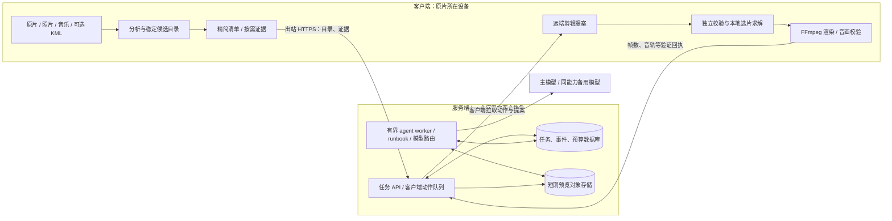
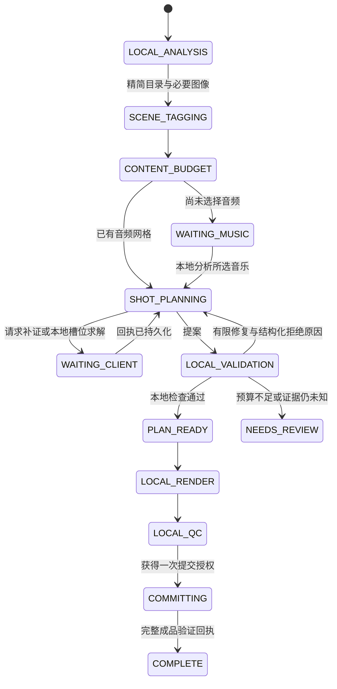

# 客户端处理素材、服务端辅助剪辑：分布式设计

状态：设计提案，2026-10-16。本文及配套协议、runbook 是后续实现的基线；当前 CLI/GUI 尚未接入远端服务。现有本地工作流继续使用。

推荐采用 **本地媒体执行器 + 有持久状态的 AI 编排服务**：原片、照片、音乐、遥测、光流、切片和编码留在客户端；服务端接收精简目录，按需查看少量图片或短预览，返回内容判断与剪辑提案。客户端重新验证提案，生成实际执行计划并渲染。

关键改进是把规则写成不可绕过的协议与本地检查，把 AI loop 限制在明确的阶段内。主备模型可以改变选择，不能改变稳定性阈值、上传权限或渲染授权。用户明确的硬要求与一般偏好分开存入固定修订的任务策略；AI 可以建议取舍，只有用户授权的策略变更才能改变硬要求。

## 1. 用户流程与职责



| 步骤 | 客户端负责的确定性工作 | 服务端 AI 负责的判断 |
|---|---|---|
| 素材整理 | 解码、遥测、光流、稳定切分、版本和来源记录 | 无需介入逐帧切片 |
| 估计适宜时长 | 有效窗口容量、重叠去除、给定约束下求解 | 归并相似场景，判断独特内容、重复感和章节 |
| 找音乐 | 展示建议时长区间，接收用户选择 | 解释为什么建议这个区间；无需上传完整音乐 |
| 音乐分析 | 完整音频的时长、采样数、节拍、能量和可选乐句网格 | 结合章节判断节奏风格；需要用户补充音乐意图时明确询问 |
| 选片组织 | 排序、方向、倍率、无重叠、旋转间隔、节拍槽位求解 | 哪些镜头有内容、哪些相似、人物/车辆状态、开场和收尾 |
| 执行 | 精确窗口再评估、照片变换、渲染、音画检查、输出报告 | 对少量有歧义的实际预览补充判断 |

“适宜时长”不等于稳定片段时长之和。AI 将相似素材归为场景组，客户端按组内限额、连续运镜长度、照片展示时间、顺序和去重约束求出几个可行方案，再反馈例如“紧凑 / 标准 / 舒展”的时长区间及置信度。没有完整语义证据时，只能给容量上限和暂估区间。

已经提供音乐时跳过等待；否则进入 `WAITING_MUSIC`，不消耗模型调用等待用户。加入音乐会产生新的计划修订，保留仍有效的素材分析与场景证据。

路线有 `capture_order`、`regional_route`、`no_track` 三种产品策略，分别映射到现有本地排序器。沿途侧方山体、远处景观可以插入：AI 识别内容，客户端核验区域进度、可测方向与顺序。无人机位置不等于被摄景物位置；无法确定时保留 `unknown`。v1 远端协议只支持正放，倒放留待加入独立的窗口级物理与语义检查后扩展。

## 2. 最小上传策略

不要直接上传现有 `_segments.json`、`_edit.json` 或逐帧 CSV。它们包含本机路径和大量重复分析，且不是可信的网络输入协议。

采用四层证据，先便宜后昂贵，已知不合格的片段无需生成预览：

| 层级 | 内容 | 用途与边界 |
|---|---|---|
| L0 目录 | 匿名资产 ID、相对拍摄顺序、候选范围、运镜/容量摘要、通道来源、可选粗粒度路线进度 | 先缩小候选池；不能凭这些推断具体人物/景物 |
| L1 图像 | 按候选选择的起中末帧、带映射表的联系表、照片缩略图 | 场景归并、内容丰富性、构图；稀疏图像不能认证连续运动 |
| L2 短预览 | 有歧义窗口的无声低分辨率视频；支持选定倍率与目标输出帧率 | 区分停车/行驶、先拉远后拉近、短时摆动；只证明实际观看覆盖范围 |
| L3 本地评估回执 | 精确窗口活动性、规则检查和本地评估引用 | 原始光流/遥测留本地；模型不能用回执补造未测量的语义 |

默认不上传完整原片、稳定切片文件、原始照片、音乐文件、精确 GPS 或最终成片。服务端和模型供应商会看到实际上传的派生预览；这是数据边界，不能宣传成“画面完全不离开本机”。用户可选择只传目录，此时视觉判断需要本地复核，不能假装 AI 看过画面。

最近一次含视频与照片的项目提供了一个量级参照：本地数值扫描 JSON 约 93 MB，带重复评估的候选 JSON 约 2.6 MB；音乐分析约 14 KB，四页最终成片联系表合计约 1.5 MB。后两项不是自动选片全过程的实测流量。下面是初始产品预算，需通过实际任务校准：

| 项目 | 建议初值 |
|---|---|
| 首次目录请求体 | ≤256 KiB，超出则分页，声明总数和完整性 |
| 探索性联系表 | 全任务目标 ≤3 MiB，限制像素与图片数量 |
| 单段视频预览 | 常用 6 秒、360p、30fps、无声；600 kbit/s 的视频负载约 450 kB，封装开销另计 |
| 客户端总上传 | 12 MiB 软限、20 MiB 硬限；包括目录、证据和实际重传字节 |
| 预览次数 | 初值最多 12 段；可由用户任务策略调整，不能由模型上调 |

目录分页不必全部塞入一次上下文：先批量标注，再用紧凑场景摘要规划。图片像素、供应商图片/token 上限、上下文长度、模型费用与上传字节分别计数；压缩成小 JPEG 不代表模型成本也小。

联系表可以复用本地缓存，但必须标出真实采样位置；近似缩略图只能作内容参考。本地可用相邻时间、粗位置、感知哈希先减少近似重复，再让 AI 看代表帧；这些分组只是候选压缩，不冒充语义判定。检查加速后的顿挫时，短预览要按目标倍率和输出帧率生成。降低帧率的预览不得拿来证明输出运动平滑。

## 3. 数据契约与本地权威

机器可读契约见 [edge-cloud-v1.schema.json](../contracts/edge-cloud-v1.schema.json)，合成样例和额外约束见 [协议说明](../examples/edge-cloud-v1/README.md)。协议与现有内部 JSON 分开演进，未知字段默认拒绝。

### 身份、时间、来源

- `asset_id` 是项目内随机 ID；本机维护它到路径的映射。`source_revision` 对应本地完整内容摘要和媒体属性的不可变记录，服务端不用知道原片路径或全局可追踪的原片哈希。
- 文件大小与 mtime 仅用于快速失效提示，不能证明内容相同。首次计算内容摘要；恢复/渲染前重新确认被引用素材的版本。执行时检测到文件改变就停止接受该版本的结果，重新分析。需要严格快照保证时使用本地只读快照；普通可写文件上的 stat 检查不构成绝对的防修改保证。
- 源窗口使用规范化有理数秒 `{num, den}`，区间为 `[start,end)`；输出位置使用整数帧，倍率使用正有理数。`3/2` 表示 1.5×。不得先四舍五入到毫秒，或用输出帧率推算原片 PTS。
- v1 支持当前 DJI CFR 工作流；声明源帧率和 time base。VFR 输入返回 `unsupported`，或先在本地转换并建立新版本及时间映射，不能静默按 `frame/fps` 处理。
- 证据范围绑定资产版本、实际源窗、倍率、输出 FPS、变换、规则和分析器版本。输出 146 帧、30fps、1.5× 实际消费 `146/30 × 3/2 = 73/10` 秒原片；必须评估这 7.3 秒，不能拿父段或另一截窗授权。
- JSON 哈希采用 [RFC 8785 JCS](https://www.rfc-editor.org/rfc/rfc8785) 后 SHA-256，并在哈希前约分、校验有理数。整数限制在跨语言安全范围内；拒绝重复键、NaN 和 Infinity。本地编译计划的内容摘要不含传输字段；`proposal_sha256` 绑定完整不可变提案消息，`scope_sha256` 绑定完整 scope 对象，三个哈希域不能混用。

哈希输入为 `UTF-8(domain) + NUL + JCS(payload)`，域分别为 `dronesift.scope.v1`、`dronesift.proposal_message.v1`、`dronesift.compiled_plan.v1`。最后一个域的 payload 是客户端编译器生成的规范计划内容，不是直接删几个字段后的模型输出；具体字段必须在实现该编译器时固定。

通道要记录 `measured / derived / unavailable / unknown` 及来源。现有 [SRT 转换](../../dronesift/srt.py) 对缺失云台角度会填零；“数组存在、数值有限”不能升级成真实测量。来源不明的旧缓存须补录或保持未知。可根据已有真实画面证据评估，但不能宣称测到了缺失云台通道。

### 五类主要消息

| 消息 | 可信生产者与作用 |
|---|---|
| `manifest` | 客户端登记资产、候选、规则版本、音乐网格（可为空）和预算；只包含允许上传的字段 |
| `evidence_request` | 服务端运行时签发已验证的有限动作：`frames`、`video`、`evaluate_window`；模型输出只是动作建议 |
| `evidence_receipt` | 客户端报告实际范围、实际 PTS/输出帧、对象摘要/字节、覆盖程度；对象完成上传后才可引用 |
| `edit_proposal` | 服务端返回 ID、源窗口、输出帧区间、倍率、变换和意图；不包含具有授权效力的质量 profile |
| `validation_receipt` | 客户端报告验证结果；本地可信数据库中的记录决定是否可渲染，云端复制件只作状态和审计 |

服务端只通过动作 ID 和登记资产请求本地能力。控制协议另包含任务创建/取消、目录分页、动作领取/确认、预算预留、槽位求解、提案修复与完成回执；这五类 schema 是媒体契约基线，不是完整 HTTP OpenAPI。

本地执行器是最终权威。远端提案进入专门的严格编译入口，按 ID 重新获取本地数据，**不直接把远端 JSON 交给 `render_montage` 或现有 `--plan`**。编译器必须：

1. 检查任务修订、来源版本、目录摘要、音频版本、规则和能力是否一致。
2. 根据输出帧与倍率推导真正消费范围，确认在稳定候选内，对该范围重新计算活动性、扰动与倍率 profile；1× 也不能绕过新协议的检查。槽位求解结果应先进入提案；校验发现范围不匹配则返回违例，不静默移动源窗。更换窗口后检查原语义证据是否仍覆盖。
3. 重新计算顺序、路线、无重叠、旋转间隔、内容组限额、完整音频与帧槽位，不接受模型自报的 `quality/profile/max/rotation` 等作为事实。
4. 核验语义要求的证据覆盖和来源；未知的人物状态、停车状态、照片主体范围可以阻止自动完成。
5. 建立本地验证记录，绑定规范化计划摘要、媒体/音乐版本、输出配置、设备/任务/修订、规则与分析器版本。渲染时通过不透明 `receipt_id` 查本地数据库，不能只检查请求里有没有 `passed:true`。

现有 [playback.py](../../dronesift/playback.py) 允许部分未评估的原速旧计划继续使用。这个兼容行为应留给旧本地入口，不能成为远端导入的捷径。现有 `validate_plan` 中的自带 profile/语义字段也不能直接信任。

规则估计与视觉判断分开保存。倍率 `null` 是证据不足，`0` 是没有通过的测试档位，最高测试档 4× 不等于无限加速。AI 声明必须标明 `ai_vision`、引用哪些帧/短视频、覆盖 `sparse_frames` 还是 `short_proxy`、置信度和 `unknown`。真人连续审片记录仅由本地交互产生；模型不能填一个 reviewer 字符串来制造真人审核。

照片展示时长属于输出时间，不能伪造源视频运动。照片裁切的几何合法性由客户端验证，是否裁掉主体由视觉证据或真人判断。音乐在本地完整分析；远端只接收时长、采样信息、节拍/能量网格及可选用户描述，不需要 MP3。默认保留完整音乐且没有无声尾部；用户显式允许 1–2 秒无声收尾时，由任务策略增加输出帧预算，模型不能自行延长或截歌。

## 4. 有界、可恢复的 agent loop

采用固定阶段状态机，阶段内部才允许少量工具循环。不要让一个持续增长的聊天记录充当任务数据库。



`CANCELED / FAILED / EXPIRED` 可从任意未结束阶段进入；客户端断线用 `WAITING_CLIENT` 表达。`PLAN_READY` 不代表成品完成。执行状态与 `quality_mode = ai_reviewed / cached_semantics / rules_draft / human_reviewed` 分开；模式标签不是舒适度保证。

推荐分成两个 AI 角色，不需要两个互相聊天的 agent：

- **scene_tagger**：分批看联系表，输出场景组、独特内容、主体及活动状态、需要补证的疑问。每项绑定证据和来源版本，未知可保留。
- **sequence_editor**：结合时长方案/音乐槽位，输出章节、候选偏好、镜头意图和备选。调用客户端 `solve_local_slots`，由本地确定性求解器满足实际规则；收到拒绝原因后有限修复。

标题、OCR、文件名、照片里的文字和用户素材说明均作为数据；它们不能增加工具权限。模型只看到当前阶段需要的摘要和白名单 schema。短预览、窗口评估、本地求解都是有界工具，不暴露 shell、FFmpeg 参数、任意路径、任意 URL 或目录遍历。

配套 [runbook 示例](../examples/edge-cloud-runbook.json) 固定阶段、工具、硬门槛、修复次数和失败去向。runbook 由可信维护者发布；服务启动时校验引用工具/能力是否存在，缺失就拒绝启动相应能力，不能悄悄退回宽松工具集。任务固定 runbook、提示词、协议、模型路由和规则版本；升级时显式新建修订。

实际调用前，运行时将当前 runbook 阶段的说明与工具 schema 注入提示词，并记录它们的摘要。持久化结构化决策、未解问题、证据引用和工具结果，不保存或依赖模型隐藏思维链。切换模型时从这些记录重建上下文，共用原来的预算和已提交动作，不重跑整个任务。

每次循环的执行次序：

```text
领取步骤与 lease_epoch → 载入固定版本的 runbook / 已验证证据
→ 检查缺失输入与剩余预算 → 事务性预留本次调用额度
→ 以剩余截止时间调用满足能力的模型 → 记录用量/未知计费
→ 校验结构与工具权限 → 幂等登记有限客户端动作或提交提案
→ CAS 提交步骤结果与下一事件 → 释放租约；等待输入时停止调用
```

## 5. 主备模型与兜底

[模型路由示例](../examples/model-routing.json) 按角色声明能力。`glm-5.3-flash` 的官方资料包含图像、视频输入和工具调用，适合作为待验证的主模型候选；实际效果需用本项目素材评测，接入渠道与适配器也必须真的传递图片。[官方能力说明](https://docs.z.ai/guides/vlm/glm-5.3-flash)

能力注册至少区分 `images / multi_image / video / tools / structured_output`，并记录接入端、适配器版本、限制和探测结果。启动/升级时用已知合成图片和工具回执做契约探测；仅配置 `supports_images:true` 不算通过。备模型要求满足当前阶段的实际能力和已批准的数据处理范围；不能把图片变成文字占位后继续视觉判定。

| 故障 | 处理 |
|---|---|
| 连接故障、429、可重试 5xx | 有限退避重试，尊重 Retry-After，受剩余时间与共享预算限制 |
| 密钥无效、权限不足、端点/模态不支持 | 不重复同一请求；禁用该路由，选择符合能力的备用路由或明确降级 |
| JSON/工具参数错误 | 一次结构修复；仍失败转同能力备用模型或结束当前阶段 |
| 提案不满足本地规则 | 返回精确违例，有限重新选片；不能为了填满音乐放宽规则 |
| 视觉证据缺失 | 请求有预算的补证；仍缺失则保留未知，进入待复核或材料不足 |
| 客户端离线 | 等待回连，释放 worker；不持续调用模型询问是否恢复 |

兜底顺序为：有限重试/修复 → 同能力备用模型 → 复用同一素材版本下已验证的语义记录 → 本地确定性草稿 → 待复核/不足报告。复用缓存要保留原观察范围和判断来源。

本地规则草稿可以使用已知场景组做顺序与节拍求解；缺少语义时不能保证人物在动、景观不重复或照片主体保留。硬约束不通过就返回 `INSUFFICIENT_MATERIAL` 和缺口，不能用循环镜头、静帧、改变速度上限或偷偷截短音乐来装作完成。视觉要求仍未知时返回 `NEEDS_REVIEW`，附本地审片包。

预算按任务共享，并在并发调用前原子预留：总模型调用次数、输入/输出 token、费用上限、图片像素、预览数、上传字节、本地 CPU/编码并发、活跃 AI 时间及任务存活时间。初始可设活跃 AI 5 分钟、离线任务保留 24 小时；活跃时间只累计服务端实际执行（包括模型在途时间），本地分析/验证/渲染与等待设备、用户均不计入。本地动作使用自己的 CPU/墙钟预算，与任务剩余存活时间共同约束，不能把 5 分钟 AI 预算当作长视频分析的截止时间。

请求超时不代表供应商没执行或没计费。记录 `usage_unknown`，保留该次最坏额度，待对账再释放；备用模型不能重新获得一份完整预算。不能承诺模型调用/计费恰好一次。模型调用超时裁到剩余活跃预算和任务存活时间；客户端动作超时按自己的类型预算计算。客户端执行收到的剩余时长用本机单调时钟计时，不能假设双方墙钟完全一致。

## 6. 分布式协议、持久化和恢复

客户端只需出站 HTTPS。首版用长轮询拉取动作（例如 `wait=25s`）、POST 回执；SSE 可以通知进度，不能承担可靠队列。客户端无须开放端口，也无须建立对原片目录的远程文件服务。

建议 HTTP 资源如下；具体鉴权和完整 OpenAPI 在实现阶段补齐：

| 接口 | 语义 |
|---|---|
| `POST /v1/jobs` | 建立任务，固定设备、修订、用户约束、runbook 与预算；要求 Idempotency-Key |
| `PUT /v1/jobs/{id}/catalog/pages/{page_id}` | 幂等登记目录页，完整后提交目录摘要 |
| `GET /v1/jobs/{id}/actions?cursor=…&wait=25` | 按持久游标拉取未确认动作；领取不等于执行完成 |
| `POST /v1/jobs/{id}/results` | 回执持久提交，返回确认游标；重复相同结果返回原确认 |
| `POST /v1/jobs/{id}/artifacts` | 申请有预算的预览上传对象；目标由服务端固定配置 |
| `POST /v1/jobs/{id}/proposals/{proposal_id}/validation` | 接收客户端检查结果，只作云端记录 |
| `POST /v1/jobs/{id}/publish-grants` | 在线提交策略下以 CAS 争取一次提交授权；进入 `COMMITTING`，仍等待本地回执 |
| `POST /v1/jobs/{id}/cancel` | 提交授权前以 CAS 取消并增加修订；若提交授权已生效则明确返回已进入提交 |
| `GET /v1/jobs/{id}/events?after=…` | 有序进度回放，可供 GUI 断线恢复 |

上传 API 使用受限对象 ID；应用客户端只认登记的服务/对象存储目标。对象经过摘要、实际字节与媒体属性检查后进入 `COMMITTED`，此时证据才可用。上传一半、预先声明的字节数、模型猜测的对象 ID 都不能算证据。上传采用小对象重试或受控分块续传，重试的实际网络字节同样计预算。

客户端 SQLite 保存：资产/路径映射、内容版本与来源、分析缓存键、动作收件箱、待确认结果、实际上传计数、验证记录、分段渲染清单。收到动作先持久化，执行后先持久化结果再发送；断线重发原结果，不再生成同一预览或重复编码。

服务端 PostgreSQL 至少保存：`jobs / stages / attempts / client_actions / artifacts / decisions / budget_reservations / events / outbox`。所有外部操作前记下 attempt、输入摘要和预算预留；状态变化与 outbox 事件放同一事务。任务内所有查询、去重键、缓存和对象引用均带租户授权，不能只靠一个难猜 ID。

worker 使用短事务 `SELECT … FOR UPDATE SKIP LOCKED` 领取可运行步骤，增加 `lease_epoch` 并设置租约，然后提交事务再调用模型，不能持有数据库锁等待网络。该机制适合多消费者任务表，[PostgreSQL 文档](https://www.postgresql.org/docs/current/sql-select.html) 同时说明它不适合一般一致性查询。

结果提交使用比较并交换：必须匹配 `tenant + job_revision + stage_input_digest + lease_epoch` 且租约仍有效，才能推进步骤和写下一事件。超时后由新 worker 接手，旧 worker 的迟到结果仅记审计/费用，不能覆盖新状态。租约到期不表示旧供应商调用被取消。

动作与结果采用至少一次投递、幂等接纳。幂等键包含任务修订、步骤、输入摘要、动作类型及规范化参数；同 key 不同输入返回冲突。同一动作重复领取读取已保存结果，避免重复上传。外部模型调用可能重复，系统承诺的是结果接纳幂等和重复费用可追踪。

恢复从结构化步骤与证据账本继续。候选扫描、预览和渲染 part 缓存键绑定源版本、窗口、倍率、输出帧/FPS、变换、编码配置及实现版本；采用前检查帧数、可解码性和摘要。文件存在或以前“成功过”都不充分。规则版本变化只复用仍合法的原测量，不沿用过期的判断结果。

最终渲染先写本地临时输出，完成帧数、时长、音轨和计划一致性验证后原子提交；恢复时可复用通过验证的 parts。不得用补静帧掩盖短了一帧的切片，正常 CFR 的时间采样策略则应显式记录。最终成片默认只留本机，云端只收到验证回执。

### 取消和离线的实际边界

仅在发布前 GET 一次取消状态仍有“查询之后、文件重命名之前”的竞争。在线提交策略用服务端 CAS 决定谁先获准：取消先成功则提升修订并停止派发，客户端不得取得旧修订的提交授权；提交授权先成功则任务进入 `COMMITTING`，后来的远端取消明确返回 `TOO_LATE_FOR_ATOMIC_CANCEL`，不能假报取消成功。可以继续请求本机尽力停止，但不能承诺撤回已经发布的文件。

提交授权绑定设备、计划和本地验证记录，只允许该设备使用一次。客户端先持久化 `commit_request_id` 再申请；服务端原子保存授权，响应丢失后，同设备/修订/计划重试返回同一授权，不能因为已是 `COMMITTING` 就永久冲突。收到本地成功回执才进入 `COMPLETE`。

设备在授权后断开或崩溃，保持等待同一设备恢复，不能仅因超时就将授权重发给另一台设备。客户端在 SQLite 中记录提交状态，再原子重命名；崩溃后核验输出并重发同一回执。用户在本机点停止时，先持久化取消标记，再向界面报告成功；停止状态与本地提交状态通过同一把锁/事务串行化，重连先同步取消，不能让旧动作复活。

授权后若本机停止先于发布、磁盘写入失败或素材版本失效，设备报告“确定未发布”的 `COMMIT_ABORTED / COMMIT_FAILED`，授权保留为不可复用终态。远端超时或设备不可达只能表示提交结果未知，不能推断文件没有发布。

远程取消无法即时送达断网设备。必须明确二选一的任务策略：

- `online_commit`（默认）：断网可以继续已授权计算，成品先留临时区；回连取得上述提交授权后再提交正式输出。若断线发生在已获提交授权之后，则按该授权恢复。
- `offline_local_export`（用户预先选择）：允许在断网时导出本地文件，本机停止按钮仍立即生效；云端取消要等回连才被设备知道。该文件不能自动登记为后来已取消修订的成功结果。

不要同时承诺“离线自由发布”和“远程取消即时阻止发布”。任务授权可以沿用用户已明确的自动生成请求，无须给每一个预览/动作增加人工确认。

## 7. 从参考 agent loop 借鉴什么

参考实现按机制审阅，下面是迁移建议；本项目不复制其中的业务 runbook、客户配置或凭据。

| 参考位置 | 借鉴 | 本系统需要加强的部分 |
|---|---|---|
| `agent_core`、`runbook_prefetch` | 将 runbook/工具 schema 注入上下文，预取必要证据 | 版本固定、预取有硬截止时间，所有证据可复用且有 scope |
| `execution_contracts` | 必需步骤完成契约 | 缺少工具时显式失败，不能让硬约束未激活 |
| `run_budget` | 给收尾留预算，限制循环 | 调用前原子预留，单次工具/模型超时受剩余额度约束 |
| provider/token plan | 主备路由、可重试错误分类 | 按实际模态和适配器能力切换；视觉输入不得悄悄转成文字 |
| evidence digest / reporting ledger | 证据摘要、工具耗时与错误记录、无模型时收尾 | 记录质量模式、未知、实际成本；摘要不能伪装完整审片 |
| inflight journal | 未完成任务重启恢复 | 升级为步骤级状态、租约代次、客户端 outbox、幂等回执；不是整任务重跑 |

参考代码里当前部分备模型路径会将图片内容压平成文本；这对视觉选片不可接受。其内存对话切换与整任务重放，也不足以承担分布式工作流的恢复。这里采用独立的持久状态机，将聊天上下文降为可重建的调用输入。

## 8. 首版部署与数据边界

首版用一个服务应用（API 与 worker 两种运行角色）、PostgreSQL、私有预览存储，客户端继续 Python/FFmpeg/现有 GUI。自托管也能使用同一协议。数据库任务表足够承担初期队列，无须先引入 Redis、Kafka、Kubernetes 或工作流平台；有真实并发压力后再拆。

API 和 worker 可独立扩容，模型调用受全局并发和每租户配额限制；客户端分析/编码并发由本机资源决定。云端不需要 GPU 或原片转码集群。增加客户端设备时，需要在新设备上找到相同素材版本；云端预览不能恢复丢失的原片。

模型密钥留服务端，以密钥引用接入；公开配置不放凭据。预览对象私有、按任务隔离、短期保留，可先采用 48 小时设计值；清理前检查活动引用，不能让排队中的模型突然读到过期对象。供应商侧留存能力依其真实接口/合同配置，不承诺自动零留存。

上传前去掉 EXIF/GPS、本机路径和未授权音轨；错误上报只含稳定错误码、资产 ID 和脱敏信息，完整 traceback/命令留本地。精确 KML/GPS 可只在本机用于方向和排序，上传相对进度/区域标签即可。缓存不跨租户共享；访问预览的短期凭据不能写入提示词日志。

对象本身是否敏感取决于画面内容；删掉 EXIF 不会删掉画面里可见的地址或人物。因此租户的上传策略和供应商允许列表必须在运行时生效，模型不能扩大它们。

## 9. 实施顺序与验收

| 阶段 | 交付与验收条件 |
|---|---|
| P0 本地边界 | 精简目录导出、来源标记、精确时间与版本；严格提案编译器从本地重建事实，不信任云端 profile；保持现有 CLI 可用 |
| P1 完整纵切 | 一个模型、一个 runbook、按需图像/视频、持久任务/动作/预算、本地渲染和完整回执；断线重连能完成同一任务 |
| P2 故障与替代 | 模态探测、主备切换、局部修复、规则草稿/待复核、成本未知处理；通过下表故障注入 |
| P3 产品与评估 | GUI 连接服务、时长建议和上传进度、任务版本迁移；对不同素材做模型 A/B 后再确定默认路由 |

P0 可复用现有 `djmd/srt → flow → segment → shot_quality/playback → montage → render`。远端新增独立的 `client/catalog`、`client/evidence`、`client/compile_proposal`、`client/journal` 适配层；服务端用 `jobs`、`agent`、`providers`、`artifacts` 等模块。这里的模块名是实现建议，当前并不存在。

协议 schema 校验只是第一道门：分数约分、结束大于开始、版本/ID 引用、实际源消耗与输出帧吻合、累计预算、消息可信生产者和本地凭据真实性必须由代码检查。正例可解析不等于网络服务或渲染授权已实现。

| 必测场景 | 期望结果 |
|---|---|
| 提交成功但确认丢失；动作/回执重复与乱序 | 重发原结果、不重复编码或上传、不重复推进 |
| worker 在模型返回前后崩溃、租约过期 | 按步骤恢复；旧执行代次不能覆盖；重复调用费用可查 |
| 多个并发请求同时接近预算 | 预留事务保证不超硬限；未知计费保留额度 |
| 备用适配器吞图片、跨租户 ID、任意路径/URL/命令 | 能力检查或授权拒绝，不能降为无图视觉判断 |
| 原片替换（含同大小并保留 mtime 的覆盖）、源窗裁短、输出 FPS/规则升级 | 旧证据/凭据失效；父窗不能授权新裁窗，旧 1× 兼容入口不能绕过 |
| SRT 云台补零、缺通道、近似缩略图、采样不足 | 来源真实、保持未知，不伪装实测或连续审片 |
| 取消与完成竞争、设备离线、成片写完未提交即崩溃 | 采用明确提交策略，旧修订不能登记完成，恢复时验证临时输出 |
| 预览传一半、超限、摘要错误、缓存过期 | 不生成可用证据引用，实际重传计数，不拿残缺画面继续判断 |
| 29.97/59.94fps 裁窗、照片插入、完整音乐末尾 | 精确帧数/消费范围和音轨校验，不能靠补帧或截音乐掩盖 |
| 模型全部不可用或素材不足 | 受限草稿、待复核或明确不足；不自动改规则凑成片 |

模型评估使用冻结候选、音乐网格和同一规则版本，对比规则基线、主模型、备用模型；不把本次人工选好的镜头表放进测试提示词。分开统计：本地硬约束通过率、恢复成功率、实际上传量、模型费用、用户修改次数，以及盲评的重复感、丰富度、连贯性和舒适度。已有本地单测不能证明新网络协议可靠，也不能证明 AI 的审美质量。

配套文件为设计原型，不含 API 服务、付费模型调用或新上线能力。先做 P0/P1 的一个完整任务，比先拆许多微服务更能验证这条数据边界是否成立。
