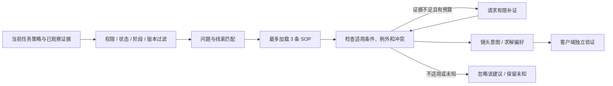

# 从用户反馈沉淀剪辑 SOP

状态：2026-10-16 设计修订；配套 JSON 均为设计示例，尚无运行时、自动学习结果或效果提升数据。承接[客户端与服务端设计](distributed-editing.zh-CN.md)。

建议将上一版的固定流程扩展为 **固定执行内核 + 任务策略 + 可学习剪辑 SOP + 个例证据**。航拍的题材、主体、运镜、叙事、音乐与播放速度形成许多组合，事先按景点穷举 runbook 很难维护。适合成长的是“如何观察和组织内容”的经验；权限、预算、恢复及本地质量校验仍由代码掌握。

## 1. Hermes 提供的启发与边界

本次通过用户指定的 SSH 技能，只读查看了 Hermes 部署中的提示词、技能管理、后台回顾、Curator 和 SOP 的组织方式。没有修改远端文件，也没有运行模型或维护任务。源码采样与在线文档不保证版本相同，不能用在线最新功能推断某个部署已启用。

| 机制 | 核对内容 | 对本项目的意义 |
|---|---|---|
| 按需加载 | `prompt_builder` 建索引；`skills_list / skill_view` 分开发现、正文和参考资料 | 上下文放少量相关 SOP，不把整个经验库拼进提示词 |
| 会话回顾 | `background_review` 从会话快照提炼经验，受限于记忆/技能工具 | 反馈能自动产生经验候选；学习不应阻塞当前成片 |
| 技能管理 | `skill_manage` 支持创建、局部更新、参考文件与来源记录 | 优先维护同类流程，案例放参考层，不是一任务一技能 |
| Curator | 定期归并同类技能、归档、备份与维护索引 | 经验库本身也需要去重、版本和回滚 |
| 所有权与更新策略 | 部署中的文档并非都允许自动改写，历史案例也要求本次重新取证 | 区分自动经验、用户维护 SOP、外部同步资料；历史结论不充当当前事实 |

Hermes 的公开文档也将 skill 定位为按需加载的过程知识，并支持 agent 维护；简短持久事实与长流程分开存储。[Skills System](https://hermes-agent.nousresearch.com/docs/user-guide/features/skills)、[Persistent Memory](https://hermes-agent.nousresearch.com/docs/user-guide/features/memory)

本项目借鉴这些机制，同时做两处适配：使用可恢复的服务端学习任务代替仅依赖进程内后台线程；新增经验先进入私有候选和有限试用，不直接覆盖当前生效流程。`NO_CHANGE` 是正常结果，不以“调用了很多工具”或“每次必须写一点”作为学习指标。

## 2. 四层知识，分别更新

| 层 | 示例 | 更新方式 |
|---|---|---|
| 执行内核 | 上传范围、工具白名单、幂等/取消、精确源窗、倍率与音画验证 | 代码/协议变更，测试与版本迁移；模型无写权限 |
| 任务及用户策略 | 此片按拍摄时间排序、不要连续旋转、允许独特停车观察镜、优先 1.5× | 用户明确要求立即生效并固定修订；记录项目级还是用户级偏好 |
| 剪辑 SOP | 如何验证车辆持续行驶；如何识别冗余停车插入；照片如何接入运动章节 | 自动提炼私有候选，有限试用、回放比较，再决定推广或撤回 |
| 个例证据 | 某版本某源窗有反向调整；某远景只有一个窗口可见 | 精确绑定素材/窗口/倍率/证据与判断者，不直接泛化 |

当前用户要求优先于旧偏好和 SOP；物理检查与授权不能被任何 SOP 绕过。任务策略改变后创建新计划修订，重新验证受影响部分。现有 v1 媒体协议只开放客户端支持的策略；SOP 不能增加协议不支持的播放方向或规则配置。

例如“不连续旋转”可以是此用户的长期偏好、此片的硬要求，也可以在另一种影片中只是软偏好。记录它的作用域和用户原意，不能因本片反馈便设成全体用户永久不可更改的规则。

## 3. 按问题复用，按证据组合

不创建“火山草场跟车 1.5× 口哨音乐版”这样绑定某次成片的流程。按可复用问题建少量类级 SOP，详细案例挂在对应类下：

- 主体动作连续性：行驶—停车—行驶、运动起步、暂停后重新运动。
- 运镜变化与播放速度：同向规律变化、突发反向、加速后的可感扰动。
- 内容重复与独特信息：相同草场与车辆里，独有远山/云层/路况是否值得保留。
- 时间、空间与叙事：连续旅行、到达停留、沿途侧景，分别使用合适的顺序策略。
- 照片与视频组织：主体构图、章节转换、照片展示时长及与音乐的关系。

“森林 / 草场 / 城市”“车 / 人 / 牛群”“跟拍 / 旋转 / 俯仰”“连续旅程 / 景观展示”等作为检索特征；一条 SOP 可以跨景观使用，一项任务可以组合多条 SOP。新场景没有匹配 SOP 时，模型仍依据用户意图和已有证据规划，执行内核照常验证，不能因为经验库没收录就停止工作。

典型例子是跟车：当前意图为“在风景中连续行驶”，中间停车镜头如果既打断动作又没有新增内容，优先裁掉或替换。但若停车镜头独有远处山体、云层或前方困难路况，它可能是必要的观察镜；已有用户许可就直接使用，不重复确认。两者均不能推出“凡是停车就删”。完整合成样例见 [editorial-sop.json](../examples/editorial-sop.json)。

## 4. 在线检索与使用

服务端先过滤租户、项目、可见范围、启用状态、阶段、规则/证据版本，再用标准标签和文本匹配排序。中文文本先做合适的分词或转换为标准标签；不能默认普通全文检索就能理解中文和视觉语义。初版不增加独立向量数据库，有检索漏召回数据后再决定是否加入向量召回和重排。

每次决策初始限额为最多 3 条 SOP 正文、合计约 3000 token，最多展开 1 个案例参考；这是可配置设计值，不是测量结果。候选摘要不等于全文；预算不足时可以减少加载。模型、检索、补证与学习共用任务费用上限，不能因“加载经验”获得额外预算。

每条建议记录：命中的理由、已知/未知的适用条件、例外检查、冲突处理、实际应用到的镜头，以及 `sop_id + version + content_sha256`。看过或检索命中不等于应用，更不等于有效。只有运行时登记的具体决策差异才计入应用次数。

候选默认不进入普通生效检索；同一项目可以按既定策略有限试用，标记 `trial` 并保留基线。一次决策最多试用一条未经跨任务验证的候选，未知条件可触发有预算的补证，不能被模型直接补为 `true`。

每个 `decision_id` 固定 SOP 快照，同一决策的重试、备模型切换重用该快照。新阶段或新决策可以另取快照，不因此提升 `job_revision` 或重置修复预算；计划记录实际应用的快照集合。若修改已应用的经验并重写已有计划，才产生新 `plan_revision`；单纯检索、未应用的建议和库更新不会改变当前成片。用户硬策略变更仍按主协议更新任务修订。

SOP 只能改变 `shot_intent / solver_preferences / bounded_evidence_requests`。检索命中也不能放宽精确窗口验证或要求上传原片；后台学习器没有客户端媒体动作权限。只有安装并经代码审查的客户端能力能执行；SOP 中的代码块不成为可执行插件。

## 5. 反馈与学习闭环

先分类，再决定存哪里，避免把所有反馈都塞进技能正文：

| 反馈 | 去向 | 不应做的泛化 |
|---|---|---|
| “这次 1.5× 比 2× 合适” | 当前任务倍率偏好；适当作用域的私有偏好 | 所有车景都应 1.5×，或覆盖片段自身倍率上限 |
| “这个窗口加速后先拉远再拉近很突兀” | 精确窗口反例；可复用的变向补证流程 | 永远删除编号 02，或禁止一切规律转向 |
| “远山、云和石堆只有这段有，可以留” | 项目中的独特内容事实与已授权例外 | 所有停车镜头都有价值，或取消连续行驶要求 |
| 规则漏检可重复的人眼扰动 | 可复现问题与代码修复候选，保留回归样本 | 用 SOP 黑名单掩盖检测器问题，或由模型修改阈值 |
| 无新增经验的顺利任务 | `NO_CHANGE`，可保留实际应用记录 | 为满足“学习数量”创建近义文档 |

反馈记录绑定真实发送者、作用域、反馈事件 ID、修改前后提案、实际观看/抽帧范围及证据来源。模型不能自填“用户已认可”；没有后续投诉、文件生成成功、模型给自己打高分都不能算正反馈。用户新上传的成片截图或口头描述也要保留其有限覆盖，不伪装完整连续审片。

当前修正不等待 SOP 晋升。用户明确偏好可按其原始作用域直接记住，无须每次确认；自动抽取出的泛化建议则进入私有 `candidate`。先查已有类级 SOP，优先补充适用条件、反例或参考，再考虑创建新类。相互矛盾的建议不能直接合并成一句模糊指令。

初始生命周期可设为 `candidate → trial → active_private`，并支持 `suspended / archived`。候选抽取不等于生效；试用先跑相同素材/音乐/规则的基线比较。跨任务扩大适用范围前，使用多个独立拍摄项目与反例验证，避免把同一段视频的多个裁窗算作多个独立样本。具体样本量与晋升阈值需要评测后设定，当前没有已验证的自动晋升标准。

默认允许自动私有候选、有限试用和代码可检查的生命周期操作，不给每次学习加确认步骤。审美泛化的自动扩大需要可靠反馈与评测门槛；缺少可信信号时维持候选/试用状态。共享 SOP 采用维护者发布的版本；私有素材、反馈和案例不能因自沉淀自动公开。用户维护或外部同步的 SOP 只允许提补丁，不能被学习器直接覆盖。

## 6. 持久化、预算和版本

继续使用现有设计中的 PostgreSQL 与 outbox，增加逻辑表 `feedback_events / sop_versions / sop_applications / learning_jobs / sop_aliases`，无需为学习另建一套分布式基础设施。

- 当前任务修正与反馈事件先持久化，再投递后台学习任务。去重键包含反馈事件、前后提案摘要、学习器版本；确认丢失不产生第二份候选。
- 学习任务沿用租约代次和 CAS 提交，输入固定会话摘要、已授权反馈及已观察证据。主备模型共用同一学习输入和费用账本；后台失败不会撤销已完成成片。
- 学习角色的模型故障、预算不足或计费未知，只让学习子任务延后/失败并保留预留，不能触发主流程的 `rules_draft / NEEDS_REVIEW` 或重置成片状态。取消父任务停止新的可选学习调用；已经在途的费用仍需对账。
- 学习子任务只能使用父任务预留且尚未消费的额度，不重置主任务预算。可先预留每任务最多 8000 token、3 次调用，均在父任务总上限内；没有额度就保存待学习事件，不继续调用。线程结束不等于结果落盘，进程退出也不能丢掉待处理事件。
- 主任务优先，可收回尚未消费的学习预留。父任务已过期或取消时不再派发；保留的事件只能在后续明确有授权预算的任务中处理，不能悄悄新建无预算的付费任务。
- SOP 正文、结构化条件、允许效果与例外均进入内容摘要。补丁绑定 `base_version + base_sha256`；并发修改产生冲突，不能后写覆盖先写。新版本不可变，校验通过才更新当前选择指针。
- 归并保留旧版本和别名指向；已固定旧版本的计划仍可重放。归档不等于删除；撤回某版本后，新决策不再选择它，旧片若需修正则新建计划修订并重新验证。
- 私有个例保留项目内 ID、摘要和观察来源，原片路径留本地。预览过期后不能声称重新看过；需要重新观察时按原有项目权限和预算请求补证。公共 SOP 仅保留经授权的泛化内容，不包含私人素材定位信息。

模型路由增加 `sop_learner` 角色，默认只需文本、结构化输出和受限的 SOP 读取/候选提交工具。它可以从真实反馈和既有判断提炼“该怎样做”，不能把未观看画面补写成新视觉事实；若提炼仍需视觉检查，由既有视觉阶段在授权范围内执行。

## 7. 最小实施与验证

先维持媒体消息协议不变，在原有服务端规划阶段增加 `sop_search / sop_view`，在反馈后登记后台学习任务；客户端继续验证同一个严格提案。配套 [runbook](../examples/edge-cloud-runbook.json)、[路由](../examples/model-routing.json) 和[合成 SOP](../examples/editorial-sop.json) 表达该分层，仍未接入运行时。

首轮只沉淀三类：运动连续性、重复与独特内容、照片接入。对同一冻结候选/音乐做“无 SOP / 固定人工 SOP / 学习后 SOP”比较，再用不同拍摄日的素材验证迁移。统计盲评的连贯性、丰富度、舒适度、用户再次修改、额外预览字节和总费用，技术合规率单独报告。

必须覆盖的反例包括：停车镜头有独特信息；两帧车位置相近但中间实际在动；同向匀速旋转被误当扰动；明确顺序要求与旧 SOP 冲突；候选把 `quality=true` 当授权；并发学习覆盖旧版本；无反馈被误计为接受；SOP 加载很多次却从未改变决策；同一素材多个裁窗被当成泛化成功；库更新后续跑任务偷偷换版本。

验收目标是减少重复犯错并保持现有质量约束，而不是 SOP 数量增长。这里的自沉淀属于外部经验库更新，不是模型权重训练；更换模型后可以复用经验，但仍需验证新模型能否正确理解和执行。
