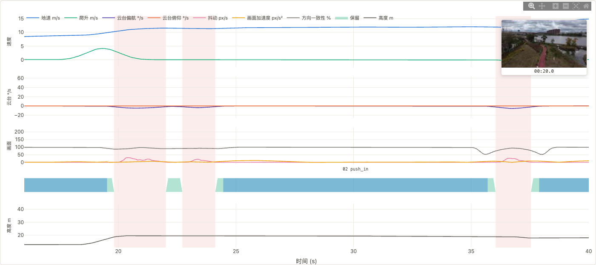
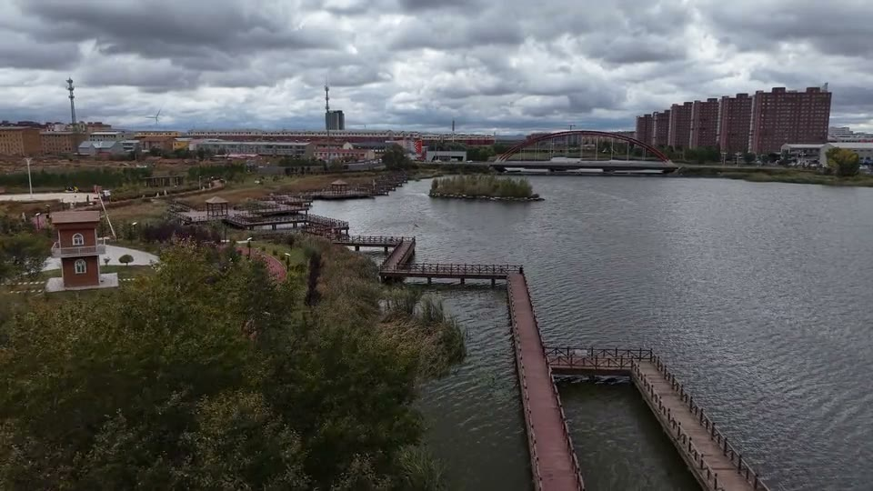
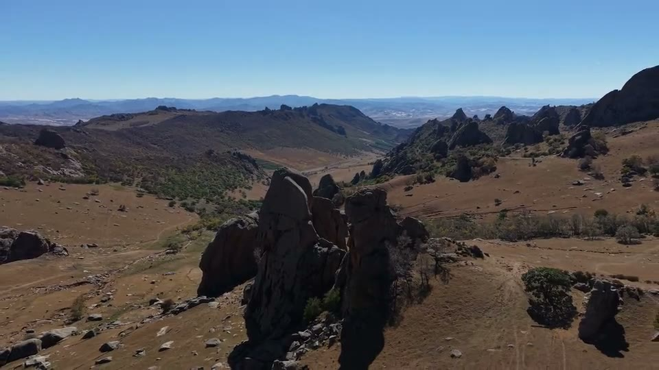

# Real footage showcase / 实拍切片展示

[English README](../README.md) · [中文说明](../README.zh-CN.md)

These small, silent previews use real DJI footage from 2026-10-01 and 2026-10-04.
Every excerpt plays forward at natural speed. The MP4 files provide the smoother
24 fps view; the GIFs are compact previews for the README.

这里展示的是实际 v6 切片结果。素材均原速正放、静音，MP4 保留 24 fps；
README 中的 GIF 用较低帧率控制下载体积。

## Flight analysis / 航拍分析

[](media/analysis-report.png)

[Open the interactive HTML example](examples/flight-report.html) ·
[Watch its 8-second selection](media/analysis-selection.mp4) ·
[Source data and capture settings](media/analysis-sources.json)

The example uses `DJI_20261004123758_0011_D.MP4`. Its cached measurements were
reprocessed with the current code and v6 thresholds; the three segment frame
ranges and labels match the saved v6 result. The older report from this flight
is not the source of these selections.

这张截图与下方视频来自同一条原片的当前 v6 结果。重建脚本用当前源码和 v6 参数
重新计算，核对片段帧范围与标签一致后才生成展示素材；没有沿用早期报告的切片区间。

| View / 视图 | What to inspect / 读图方式 |
|---|---|
| 3D trajectory / 三维轨迹 | Relative east/north/height, move colours and estimated camera-direction ticks / 相对东、北、高度，运镜分类与估计视向 |
| Speed / 速度 | Ground speed and climb rate / 地速与爬升速度 |
| Gimbal / 云台 | Yaw and pitch rates / 偏航与俯仰角速度 |
| Image motion / 画面 | Jitter, image acceleration and direction consistency / 抖动、画面加速度与方向一致性 |
| Selection / 筛选 | Rejected frames in red; frame-pass strip and final segment labels / 红底为逐帧排除区，条带与标签展示帧门禁和最终片段 |

Click a segment chip, adjust the start/end fields, or zoom a timeline to inspect
the same time range across views. Thumbnails show nearby cached keyframes;
they are not exact-frame playback. The direction ticks estimate camera view from
aircraft heading and gimbal pitch. A peak in a chart alone does not explain a
rejection: the detector also uses residuals, timing and corroborating signals.

点击片段、调整起止时间或在时间线上框选，可联动查看同一段飞行。
缩略图是附近关键帧预览，视向短刺由机身航向与云台俯仰估计。
某条曲线的峰值不直接等于剔除原因，算法还结合残差、持续时间及其他信号。

### A closer look / 局部放大

[](media/analysis-timeline.png)

The close-up shows source **16–40 seconds**, with a thumbnail preview near 20 s.
The selected middle run lies between corrections. Frame-gate acceptance is
**59.83%**, while the final three segments total **27.8278 / 74.5912 seconds
(37.31%)** after trimming and minimum-length filtering. These are selection
statistics, not keyframe-aligned copy-export durations.

局部图覆盖原片 **16–40 秒**，预览缩略图靠近 20 秒。中间一段推进位于修正之间。
**59.83% 是逐帧门禁通过比例**；边缘裁切和最短时长过滤后，最终 3 段合计
**27.8278 / 74.5912 秒（37.31%）**。这里统计的是选区，不是 copy 模式实际导出时长。

| Selected range / 选区 | Source time / 原片时间 | Move / 运镜 |
|---|---|---|
| 01 | 12.112100–19.519500 s | `push_in` |
| 02 | 24.457767–35.702333 s | `push_in` |
| 03 | 37.887850–47.063683 s | `push_in>push_in+climb` |

[](media/analysis-selection.mp4)

The matching video uses **24.457767–32.457767 s** from range 02: eight seconds,
forward at 1×, silent, downscaled to 960×540 at 24 fps. It is a frame-exact
re-encoded preview. No digital stabilization is applied.

对应视频取第 02 段的 **24.457767–32.457767 秒**，8 秒原速正放、静音，
缩小到 960×540、24 fps，按所选原片范围精确重编码。

GitHub displays HTML files as source. Download or clone the repository and open
`docs/examples/flight-report.html` in a browser to use the controls and embedded
video. Data and thumbnails are embedded; Plotly loads from cdnjs and needs an
internet connection. The example player is appended by the showcase builder;
the standard analysis report does not automatically embed a selected clip.

GitHub 会把 HTML 显示为源码；下载或克隆项目后，在浏览器打开示例文件即可交互和播放。
数据与缩略图内嵌，Plotly 图表库需联网加载。示例播放器由展示脚本附加。
公开页面保留相对轨迹，未包含绝对 GPS 和本地文件路径。

## Selected camera moves / 精选运镜

[](media/steady-moves.mp4)

[Play the 12-second MP4](media/steady-moves.mp4) · [GIF preview](media/steady-moves.gif)

| Scene / 场景 | Original source / 原片 | Source range / 原片范围 |
|---|---|---|
| Mountain reveal / 巨岩与山谷拉远 | `DJI_20261001124446_0017_D.MP4` | 4.604400–8.604400 s |
| Valley push-in / 谷地树林与田地推进 | `DJI_20261001153456_0031_D.MP4` | 38.304733–42.304733 s |
| Hiker tracking / 徒步人物与崖壁跟拍 | `DJI_20261001153939_0040_D.MP4` | 6.205400–10.205400 s |

Each four-second excerpt lies inside a reviewed v6 stable window. The sequence
shows a reveal, a forward move and one tracking turn.

每段取四秒，均落在已复核的 v6 稳定窗口内。三个镜头分别展示拉远、推进和一次跟随转向。

## Original → selected / 原片 → 切片

[](media/cut-comparison.mp4)

[Play the MP4 comparison](media/cut-comparison.mp4)

Source: `DJI_20261001123356_0013_D.MP4`.

| Decision / 处理 | Source range / 原片范围 | Duration / 时长 |
|---|---|---|
| Original excerpt / 对照原片 | 6.373033–16.449767 s | 10.0767 s |
| Keep A / 保留 A | 6.373033–10.477133 s | 4.1041 s |
| Remove correction and margins / 剔除修正及缓冲 | 10.477133–12.746067 s | 2.2689 s |
| Keep B / 保留 B | 12.746067–16.449767 s | 3.7037 s |

The selected edit joins A and B, totalling **7.807800 seconds** before frame-rate
rounding. The actual detected yaw correction lies at 10.760750–12.462450 s;
the larger removed range includes settling margins. Each side has its own source
clock because the selected edit jumps ahead at the cut. Its completion card is
an explanation overlay, outside the selected footage.

切片把 A、B 两段直接接起来，帧率取整前合计 **7.807800 秒**。
实际检出的偏航修正在 10.760750–12.462450 秒，剔除区间还包含缓冲。
右侧在切点跳过原片中的修正，因此左右各显示自己的原片时间；
右侧播完后的结束卡用于说明，不计入保留片段时长。

The previews are downscaled, frame-exact re-encodes of the selected source ranges.
The CLI's default lossless copy mode aligns to in-range keyframes, so its exported
clips can start later. The manifests record source intervals, actual output frames
and encoding settings.

展示视频按选区精确重编码并缩小分辨率。CLI 默认的无损 copy 模式需对齐区间内关键帧，
实际导出片段的起点可能稍晚。清单记录原片范围、实际输出帧数与编码参数。

## Rebuild / 重建

Use the original videos in one directory, the project environment, `ffmpeg` and
`ffprobe`. `gifsicle` optimizes the README GIFs; it is a showcase-build tool,
separate from the application runtime.

```bash
uv run python scripts/build_showcase_hero.py --source-root /path/to/20261001 --out docs/media
uv run python scripts/build_showcase_comparison.py --source /path/to/20261001/DJI_20261001123356_0013_D.MP4 --output-dir docs/media
uv run python scripts/build_showcase_report.py \
    --cuts-dir /path/to/20261004/DJI_20261004123758_0011_D_cuts_v6 \
    --video /path/to/20261004/DJI_20261004123758_0011_D.MP4
```

The report builder needs the cached telemetry, optical flow, segments and
thumbnail sprite. It checks the stored v6 ranges against the current algorithm
before rendering. Its manifest records thresholds and hashes of the source,
measurements and relevant Python code. It does not rerun the full optical-flow pass.

To reproduce the real browser screenshots, install Playwright as a separate
build tool. The following uses an installed Google Chrome; omit
`--browser-channel chrome` to use Playwright's separately installed Chromium.

```bash
npm install --prefix validation/showcase-browser playwright --no-audit --no-fund
node scripts/capture_showcase_report.cjs \
    --playwright-module validation/showcase-browser/node_modules/playwright \
    --browser-channel chrome
```

The capture script checks the segment chips, range inputs, linked plot zoom,
thumbnail preview, reset and video metadata before saving PNGs. It records
viewport, camera view and screenshot hashes in the same manifest. Playwright
and Node are only needed to rebuild screenshots, not to use dronesift.

Provenance and derived-media settings: [hero sources](media/hero-sources.json),
[comparison sources](media/comparison-sources.json),
[analysis sources](media/analysis-sources.json). The repository previews are
silent excerpts; the original 4K videos and music-backed films remain external.
